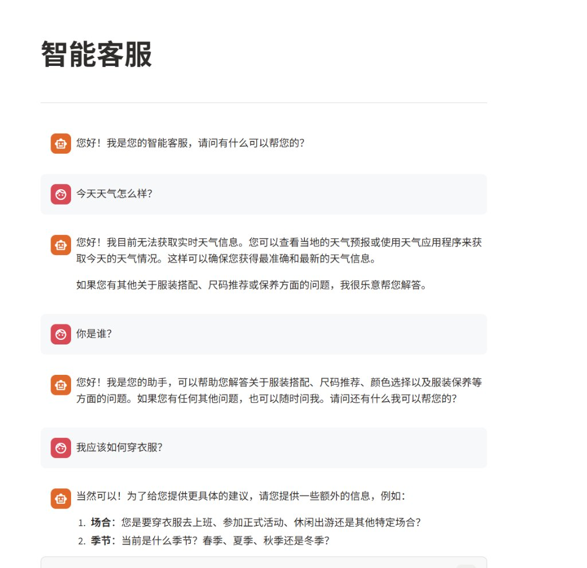

# KnowledgeBase LangChain LLM System

## 项目简介

一个轻量级、可本地复现的 RAG（检索增强生成）学习项目。上传 `.txt` 文档自动切分入库，再以聊天形式提问，由模型基于检索到的知识库内容作答。

- **知识库上传** — 网页上传 txt 文件，切分后写入 Chroma 向量库（MD5 去重）
- **RAG 问答** — `Retrieval → Prompt → LLM → Output` 链式调用，支持流式输出
- **会话管理** — 消息历史留存，支持基于历史的连续追问

> 适合作为 RAG 入门实践：依赖轻量、无需 GPU，替换成自己的业务文本即可使用。

## 效果展示



## 项目结构

```
KnowledgeBase LangChain LLM System/
├── app_qa.py               # Streamlit 智能客服问答页面
├── app_file_uploader.py    # Streamlit 知识库文件上传页面
├── rag.py                  # RAG 核心链：检索 + Prompt + 通义千问
├── Knowledge_base.py       # 知识库管理：文本切分、MD5 去重、写入 Chroma
├── vector_stores.py        # 向量检索器封装
├── config_data.py          # 全局配置（模型、分块参数、会话等）
├── file_history_store.py   # 基于文件的会话历史存储
├── chroma_db/              # Chroma 持久化向量库
├── chat_history/           # 会话历史记录文件
└── data/                   # 原始知识文档
```

## 技术栈

| 组件 | 技术选型 |
|------|---------|
| LLM | 通义千问 `qwen-max` (ChatTongyi) |
| Embedding | DashScope `text-embedding-v4` |
| 向量库 | Chroma (本地持久化) |
| 链式编排 | LangChain LCEL + RunnableWithMessageHistory |
| 前端 | Streamlit |

## 快速开始

```bash
# 1. 安装依赖
pip install langchain langchain-community langchain-chroma streamlit dashscope

# 2. 设置 API Key
export DASHSCOPE_API_KEY="your-api-key"

# 3. 上传知识库文档
streamlit run app_file_uploader.py

# 4. 启动智能客服
streamlit run app_qa.py
```

## 核心流程

```
用户提问
   │
   ▼
从输入中提取 query ──→ Chroma 向量检索（Top-K）
   │                         │
   ▼                         ▼
组装 Prompt（context + history + input）
   │
   ▼
通义千问 LLM 生成回答（流式输出）
   │
   ▼
保存会话历史 & 返回前端
```
