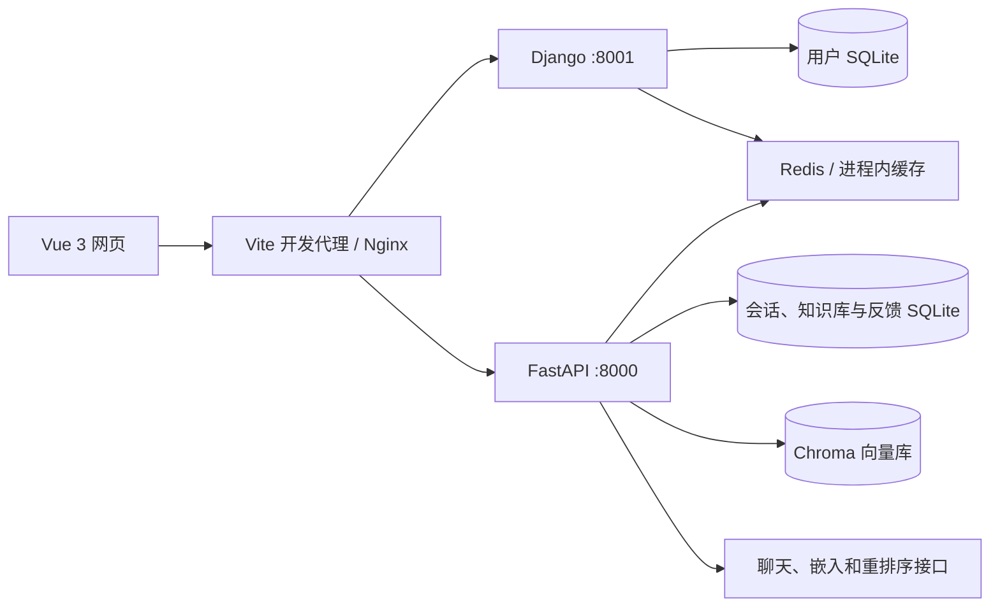

# 基于 LangChain 的 RAG 知识库智能问答系统

## 个人以学习为目的上传的第一个lanchain项目，喜欢可以点个star
## api用的是阿里百炼大模型，若不想下载源码可以直接登录http://101.37.229.182/网址来进行使用(当然api限额了，用不了多长时间)，langchain处于学习阶段，代码肯定有很多不足之处，欢迎补充与指导
面向个人和团队文档的知识库问答应用。项目包含 Vue 3 前端、FastAPI 检索与问答服务、Django 用户服务，支持多个知识库、文档上传与切片、基于文档的问答、会话管理和回答反馈。

聊天模型支持 OpenAI 兼容接口、阿里云 DashScope 和 Ollama。当前已验证的云端配置如下：

| 用途 | 模型 | 接口 |
| --- | --- | --- |
| 聊天与内容生成 | `qwen3.5-omni-flash-2026-03-15` | DashScope OpenAI 兼容接口 |
| 文本向量化 | `text-embedding-v4` | DashScope 原生接口 |
| 文档重排序 | `qwen3-rerank` | DashScope 原生接口 |

当前项目以文本交互使用 Omni 模型。

## 功能

- **账号管理**：注册、登录、JWT 鉴权、刷新令牌、修改密码、个人资料与头像上传。
- **知识库管理**：创建、编辑、切换与删除知识库，按用户和知识库组织文档。
- **文档入库**：批量上传、MD5 去重、递归分块、Chroma 向量持久化及处理进度展示。
- **知识问答**：HyDE 假设文档生成、向量与 BM25 混合检索、重排序和答案生成。
- **Agent 交互**：问候及时间等工具类问题走 Agent，内容类问题进入 RAG，通过 SSE 返回处理过程和答案。
- **内容管理**：文档详情、切片查询、会话历史、检索可视化、回答反馈和反馈统计。
- **运行部署**：健康检查、接口文档、Windows 一键启动和 Ubuntu systemd 部署。

上传接口接受 PDF、TXT、Markdown、PPTX 和 DOCX 扩展名。**当前 DOCX 加载器仍按纯文本读取，标准 Word 文档应先转换为 TXT、Markdown 或可提取文字的 PDF。** 扫描版 PDF 的 OCR 需要额外解析组件。

## 系统架构



**文档入库：** 上传 → 解析文字 → 递归分块 → 写入向量库 → 保存文档与 MD5 信息。

**问答流程：** 用户问题 → 生成 HyDE 假设文档 → 向量 / BM25 检索 → 重排序 → 总结相关片段 → 返回答案。没有可用片段时返回未检索到相关信息。

## 技术栈

| 层次 | 技术 |
| --- | --- |
| 前端 | Vue 3、Vite 7、Vue Router、Pinia、Vant、Axios |
| 内容展示 | Markdown、代码高亮、DOMPurify |
| 问答服务 | Python 3.12、FastAPI、Uvicorn、LangChain、LangGraph |
| 检索与存储 | Chroma、BM25、SQLAlchemy、SQLite / MySQL |
| 用户服务 | Django 5.2、Django REST Framework、JWT |
| 缓存 | Redis，或本地开发使用进程内内存缓存 |
| Linux 部署 | Nginx、Gunicorn、systemd |

## 目录结构

以下目录以包含 `run.ps1` 的**代码根目录**为起点：

```text
.
├── README.md
├── requirements-local.txt       # 两个 Python 服务共用的本地依赖
├── run.ps1                      # Windows 一键启动
├── run.bat
├── backend/
│   ├── main.py                  # FastAPI 入口
│   ├── .env.example             # 模型、数据库与鉴权配置示例
│   ├── app/
│   │   ├── agent/               # Agent、工具和中间件
│   │   ├── config/              # 提示词、分块和检索参数
│   │   ├── core/                # 日志、异常处理和限流
│   │   ├── db/                  # 数据库与缓存连接
│   │   ├── models/              # 数据模型
│   │   ├── rag/                 # 解析、分块、向量库和检索
│   │   ├── router/              # HTTP 接口
│   │   ├── schemas/             # 请求与响应结构
│   │   ├── services/            # 会话、知识库和反馈服务
│   │   └── utils/               # 模型工厂、鉴权和文件工具
│   └── data/                    # 业务数据、向量与 MD5 记录
├── DjangoUserService/
│   ├── manage.py
│   ├── .env.example
│   ├── DjangoUserService/       # Django 配置与入口
│   ├── apps/                   # 用户、文件和公共工具
│   ├── db.sqlite3              # 用户数据库
│   └── media/                  # 本地上传图片
├── front/
│   ├── src/                    # 页面、路由、状态与 API 调用
│   ├── public/
│   ├── vite.config.js          # 开发代理
│   └── dist/                   # 前端构建产物
├── deploy/                     # Linux 部署、服务与备份脚本
└── logs/                       # Windows 服务启动日志
```

如果打开的是外层工作区，先进入同名子目录：

```powershell
cd .\LangChain-RAG-FastAPI-Service-master
```

已经能看到 `backend`、`front` 和 `run.ps1` 时，直接执行后续命令。

## 本地快速启动

### 1. 安装依赖

环境要求：

- Windows PowerShell 5.1 或更高版本。
- Python 3.12。
- Node.js 20.19+ 或 22.12+，以及 npm。
- 可访问所选模型服务的网络和模型调用权限。

在代码根目录执行：

```powershell
py -3.12 -m venv .venv
.\.venv\Scripts\python.exe -m pip install --upgrade pip
.\.venv\Scripts\python.exe -m pip install -r requirements-local.txt

cd front
npm.cmd ci
cd ..
```

`requirements-local.txt` 包含两个后端共用的运行依赖。扫描文档所需的 OCR 工具需按解析需求另行安装。

### 2. 配置环境变量

已有可用 `.env` 时保留现有配置。首次安装可复制示例：

```powershell
Copy-Item backend\.env.example backend\.env
Copy-Item DjangoUserService\.env.example DjangoUserService\.env
```

将 `backend/.env` 配置为：

```dotenv
LLM_TYPE=OPENAI
OPENAI_API_KEY=YOUR_DASHSCOPE_API_KEY
OPENAI_BASE_URL=https://dashscope.aliyuncs.com/compatible-mode/v1
CHAT_MODEL_NAME=qwen3.5-omni-flash-2026-03-15

EMBED_MODEL_TYPE=ALIYUN
ALIYUN_ACCESS_KEY_SECRET=YOUR_DASHSCOPE_API_KEY
ALIYUN_EMBED_MODEL_NAME=text-embedding-v4
ALIYUN_RERANK_MODEL_NAME=qwen3-rerank

DATABASE_URL=sqlite+aiosqlite:///./data/chat_history.db
SQL_ECHO=false
REDIS_BACKEND=memory
DJANGO_API_URL=http://127.0.0.1:8001

SECRET_KEY=YOUR_SHARED_JWT_SECRET
ALGORITHM=HS256
LANGCHAIN_TRACING_V2=false
```

将 `DjangoUserService/.env` 配置为：

```dotenv
JWT_SECRET_KEY=YOUR_SHARED_JWT_SECRET
DB_ENGINE=sqlite
SQLITE_DB_NAME=db.sqlite3
CACHE_BACKEND=locmem

DJANGO_DEBUG=true
DJANGO_ALLOWED_HOSTS=localhost,127.0.0.1
ENABLE_TEST_LOGIN=false

CELERY_BROKER_URL=redis://127.0.0.1:6379/0
CELERY_RESULT_BACKEND=redis://127.0.0.1:6379/0
```

两处 `YOUR_SHARED_JWT_SECRET` 必须使用同一个随机字符串，可用以下命令生成：

```powershell
.\.venv\Scripts\python.exe -c "import secrets; print(secrets.token_urlsafe(48))"
```

`OPENAI_API_KEY` 用于聊天，`ALIYUN_ACCESS_KEY_SECRET` 用于原生嵌入和重排序接口。使用 DashScope 时可填写同一个有效密钥。本地基础流程使用 SQLite 和内存缓存，无需单独启动 MySQL、Redis 或 Celery worker。

### 3. 启动服务

```powershell
powershell -NoProfile -ExecutionPolicy Bypass -File .\run.ps1
```

也可双击 `run.bat`。脚本会执行 Django 数据库迁移、后台启动三个服务并检查 HTTP 就绪状态；前端依赖缺失时会尝试安装。

**启动脚本会停止占用 3000、8000 和 8001 端口的已有进程，并覆盖本轮启动对应的日志文件。** 使用前确认这些端口用于本项目。

| 服务 | 本地地址 |
| --- | --- |
| 前端 | http://127.0.0.1:3000 |
| FastAPI Swagger | http://127.0.0.1:8000/docs |
| FastAPI ReDoc | http://127.0.0.1:8000/redoc |
| Django Swagger | http://127.0.0.1:8001/docs/ |
| Django ReDoc | http://127.0.0.1:8001/redoc/ |
| 后端就绪检查 | http://127.0.0.1:8000/health/ready |

修改模型配置后，重新运行启动脚本使配置生效。

### 4. 使用知识库

1. 打开前端，注册账号并登录。
2. 创建或选择知识库。
3. 上传 TXT、Markdown 或可解析的 PDF / PPTX，等待向量写入完成。
4. 在知识库页面确认文档和切片已出现。
5. 在 AI 问答页面选择对应知识库，围绕文档内容提问。
6. 在会话、检索可视化和反馈页面查看记录与处理信息。

单文件上传接口限制为 20 MiB，批量上传总大小限制为 200 MiB。流式批量上传路径也检查批次总大小。

项目保留本地测试入口 `test / 666666`，仅在 `ENABLE_TEST_LOGIN=true` 时启用。该入口每次登录生成临时用户 ID，持续保存个人知识库请使用注册账号。

### 手动启动

排查启动问题时，在代码根目录分别打开三个终端：

```powershell
# 终端 1：Django
cd DjangoUserService
..\.venv\Scripts\python.exe manage.py migrate --noinput
..\.venv\Scripts\python.exe manage.py runserver 127.0.0.1:8001
```

```powershell
# 终端 2：FastAPI
cd backend
..\.venv\Scripts\python.exe -m uvicorn main:app --host 127.0.0.1 --port 8000
```

```powershell
# 终端 3：Vue
cd front
npm.cmd run dev -- --host 127.0.0.1 --port 3000
```

## 模型与检索配置

| 配置 | 作用 |
| --- | --- |
| `LLM_TYPE=OPENAI` | 使用 `OPENAI_API_KEY`、`OPENAI_BASE_URL` 和 `CHAT_MODEL_NAME` 接入 OpenAI 兼容服务 |
| `LLM_TYPE=ALIYUN` | 使用 DashScope ChatTongyi，模型由 `ALIYUN_MODEL_NAME` 或 `CHAT_MODEL_NAME` 指定 |
| `LLM_TYPE=OLLAMA` | 使用 `OLLAMA_BASE_URL` 和 `OLLAMA_MODEL_NAME` |
| `EMBED_MODEL_TYPE=ALIYUN` | 使用 `ALIYUN_EMBED_MODEL_NAME` 和 `ALIYUN_ACCESS_KEY_SECRET` |
| `EMBED_MODEL_TYPE=OLLAMA` | 使用 `OLLAMA_BASE_URL` 和 `TEXT_EMBEDDING_MODEL_NAME` |
| `ALIYUN_RERANK_MODEL_NAME` | DashScope 重排序模型，当前为 `qwen3-rerank` |
| `REDIS_BACKEND=memory` | FastAPI 使用进程内内存缓存 |
| `CACHE_BACKEND=locmem` | Django 使用进程内内存缓存 |

Ollama 配置示例：

```dotenv
LLM_TYPE=OLLAMA
OLLAMA_BASE_URL=http://127.0.0.1:11434
OLLAMA_MODEL_NAME=qwen3.5:0.8b
EMBED_MODEL_TYPE=OLLAMA
TEXT_EMBEDDING_MODEL_NAME=qwen3-embedding:0.6b
```

需先启动 Ollama 并下载对应模型。重排序服务仍调用 DashScope；未配置有效密钥时，该步骤失败后回退到原检索结果顺序。

检索参数位于 [chroma.yaml](backend/app/config/chroma.yaml)，当前默认 `chunk_size=200`、`chunk_overlap=20`、检索数量 `k=5`；提示词位于 [prompt.yaml](backend/app/config/prompt.yaml)。

更换嵌入模型后，应重新生成对应文档的向量。维度相同的不同模型也不能直接混用已有向量。

## 主要接口

请求与响应结构以本地 Swagger / OpenAPI 为准。受保护接口使用请求头 `Authorization: Bearer <token>`，令牌来自 Django 登录或注册响应。

| 用途 | 方法 | 路径 |
| --- | --- | --- |
| 用户注册 / 登录 | POST | `/user/register/`、`/user/login/` |
| 用户信息 | GET | `/user/detail/` |
| 存活 / 就绪检查 | GET | `/health/live`、`/health/ready` |
| Agent 流式问答 | POST | `/chat/agent/query/stream` |
| RAG 问答 | POST | `/chat/rag/query` |
| 知识库列表 / 创建 | GET / POST | `/knowledge/bases` |
| 知识库修改 / 删除 | PATCH / DELETE | `/knowledge/bases/{knowledge_base_id}` |
| 单文件 / 多文件上传 | POST | `/knowledge/add/single`、`/knowledge/add/multiple` |
| 上传进度流 | POST | `/knowledge/add/multiple/stream` |
| 文档列表 / 详情 / 切片 | GET | `/knowledge/list`、`/knowledge/detail`、`/knowledge/chunks` |
| 会话历史 / 删除 | GET / DELETE | `/chat/session/{session_id}` |
| 回答反馈 | GET / POST | `/chat/feedback` |
| 反馈统计 | GET | `/chat/feedback/stats` |

RAG 请求示例：

```json
{
  "query": "这份文档主要介绍了什么？",
  "knowledge_base_id": "登录用户拥有的知识库 ID"
}
```

省略 `knowledge_base_id` 时使用默认知识库。Agent 流式请求还可携带 `session_id`。

## 数据与日志

| 内容 | 本地路径 |
| --- | --- |
| 用户账号 | `DjangoUserService/db.sqlite3` |
| 会话、知识库和反馈 | `backend/data/chat_history.db` |
| 文档向量与切片 | `backend/data/chromadb/` |
| MD5 去重记录 | `backend/data/md5_hex_store/` |
| 本地上传图片 | `DjangoUserService/media/` |
| 服务标准输出和错误 | `logs/*.log` |
| RAG / Agent 日志 | `backend/logs/` |

备份知识库时同时保留用户数据库、业务数据库、Chroma 文件和 MD5 记录，停服后进行一致性复制。删除数据库或向量目录会丢失对应业务数据。

## Ubuntu 与阿里云部署

部署方式为 **Nginx 静态网页 + FastAPI + Gunicorn/Django + Redis + systemd**。后端以 `ragapp` 用户运行，仅监听本机，Nginx 对外提供 HTTP 入口。

当前服务器配置使用 `101.37.229.182`，网页入口为 `http://101.37.229.182/`，需在阿里云安全组入方向放行 TCP 80。项目服务和问答链路已在服务器内部验证；公网连通性以安全组设置和实际访问结果为准。当前部署使用 IP 和 HTTP，域名与 HTTPS 尚未配置。

首次部署步骤：

1. 在本地 `front/` 执行 `npm.cmd ci` 和 `npm.cmd run build`。
2. 将源码、`requirements-local.txt`、`deploy/` 和 `front/dist/` 放到服务器 `/opt/rag-service/app`。更新已有实例时保留服务器配置与业务数据。
3. 准备服务器上的两份 `.env`，除模型与数据库配置外，补充以下生产参数。
4. 首次安装执行 `bootstrap.sh`，再执行 `activate.sh`。脚本按 Ubuntu、root 权限和固定目录设计。

FastAPI 生产配置补充：

```dotenv
ENV=prod
DEBUG_MODE=false
REDIS_BACKEND=redis
REDIS_HOST=127.0.0.1
REDIS_PORT=6379
REDIS_DB=1
```

Django 生产配置补充：

```dotenv
DJANGO_DEBUG=false
DJANGO_ALLOWED_HOSTS=101.37.229.182,localhost,127.0.0.1
ENABLE_TEST_LOGIN=false
CACHE_BACKEND=redis
REDIS_CACHE_URL=redis://127.0.0.1:6379/1
DJANGO_MEDIA_ROOT=/var/www/rag-media
CORS_ALLOWED_ORIGINS=http://101.37.229.182
CSRF_TRUSTED_ORIGINS=http://101.37.229.182
```

两份配置使用独立于本地开发环境的同一个随机 JWT 密钥。更换服务器或域名时，同时调整这些地址和 `deploy/nginx.conf` 的 `server_name`。

```bash
# 首次安装与启用
bash /opt/rag-service/app/deploy/bootstrap.sh
bash /opt/rag-service/app/deploy/activate.sh

# 状态与日志
systemctl status rag-backend rag-users nginx redis-server --no-pager
journalctl -u rag-backend -u rag-users -n 100 --no-pager
curl -fsS http://127.0.0.1/health/ready

# 修改后端代码或模型配置后重启
systemctl restart rag-backend rag-users

# 数据备份：短暂停止后端，完成后恢复
bash /opt/rag-service/app/deploy/backup.sh
```

备份位于 `/opt/rag-service/backups/`，当前未设置定时备份。公网只需开放网页入口，8000、8001 和 6379 保持本机监听。

更多路径、更新方法和脚本用途见 [部署维护文档](deploy/README.md)。

## 开发检查与常见问题

基础检查：

```powershell
.\.venv\Scripts\python.exe -m pip check
cd DjangoUserService
..\.venv\Scripts\python.exe manage.py check
cd ..\front
npm.cmd run build
cd ..
```

| 现象 | 检查与处理 |
| --- | --- |
| 启动提示缺少虚拟环境 | 在包含 `run.ps1` 的目录创建 `.venv` 并安装 `requirements-local.txt` |
| Django 连接 MySQL 失败 | 本地使用 SQLite 时明确设置 `DB_ENGINE=sqlite`，否则配置 MySQL 的 `DB_*` 参数 |
| 登录成功但问答返回 401 | 检查两个后端 JWT 密钥是否一致，配置变更后重启服务并重新登录 |
| 模型返回 401 / 403 / 模型不存在 | 检查密钥、API 地址、模型名与账号调用权限 |
| 上传后检索不到内容 | 检查切片数量、所选知识库、实际解析结果及 `backend/logs/` |
| 向量维度或检索异常 | 检查嵌入模型是否与原索引一致，更换模型后重新入库 |
| Ollama 无法连接 | 确认服务已启动、模型已下载，并检查 `OLLAMA_BASE_URL` |
| 公网打不开、本机健康检查正常 | 检查安全组 TCP 80、Nginx 状态及服务器防火墙 |
| 生产页面刷新后 404 | 检查 Nginx 的 SPA 回退：`try_files $uri $uri/ /index.html` |
| SSE 进度迟迟不显示 | 检查反向代理已关闭缓冲，且问答读取超时设置足够长 |

`/health/ready` 检查业务数据库和缓存，不测试模型权限；Redis 连接失败时 FastAPI 会回退到内存缓存。模型接入需用实际问答请求验证。

API 密钥和 JWT 密钥保存在后端 `.env`，前端配置只放公开地址。数据库、上传文件、日志和包含密钥的部署备份不应提交到版本库。

## 许可证

当前项目未提供单独的 LICENSE 文件，使用和再分发前请确认原始项目及各依赖的许可条款。

